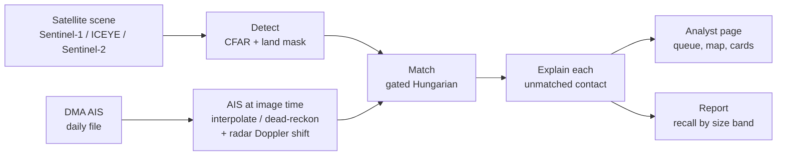

# Blue Shadow 🛰️ explained dark-vessel contacts

Blue Shadow finds ships in satellite images, checks each one against the Danish Maritime Authority's AIS data at the
moment the image was taken, and gives an analyst a short, ranked queue of the ships that **aren't** on AIS. Each one
comes with a reason code that says why it wasn't matched.

It works on **Sentinel-2** (optical, daytime) and on **radar**: **Sentinel-1** (free, works at night and through cloud)
and **ICEYE** (commercial, high resolution).

Every contact in the queue has an ID, position, time, confidence, image crop, estimated length, nearby AIS tracks, and a
**reason code**: is it a dark candidate, a vessel whose AIS dropped out, a wind turbine, coastal clutter, wind texture
on the sea…? Detection performance is reported by vessel size, with the sensor's resolution limit shown.

- [How it works](#how-it-works)
- [Repository layout](#repository-layout)
- [Setup](#setup)
- [Quick start (no downloads)](#quick-start-no-downloads)
- [Run on real data](#run-on-real-data)
- [Reading the results](#reading-the-results)
- [Command reference](#command-reference)
- [How well does it work?](#how-well-does-it-work)
- [Technical notes](#technical-notes)
- [Limitations](#limitations)

## How it works



1. **Detect** ships with a CFAR detector: it flags pixels much brighter than the sea around them, ignoring land and
   the coast (and cloud, for Sentinel-2).
2. **AIS at image time:** clean the AIS messages, then interpolate or dead-reckon every vessel to the exact acquisition
   time, with an uncertainty radius that grows with the gap since its last message. For radar, each position is also
   moved to where the radar will *show* a moving ship (the Doppler shift, often 300–500 m on Sentinel-1).
3. **Match** detections to AIS vessels one-to-one, inside each vessel's uncertainty radius.
4. **Explain** every detection without an AIS match with a [reason code](#reason-codes), backed by the evidence
   behind it. These are heuristics, not proofs.
5. **Report and display:** a single-file HTML page with a map, a priority queue and contact cards, plus recall per size
   band and a detection-limit curve.

**Which sensor for what:**

| | Sentinel-2 | Sentinel-1 | ICEYE |
|---|---|---|---|
| Type | optical (sunlight) | radar | radar |
| Night / cloud | ✗ / ✗ | ✓ / ✓ | ✓ / ✓ |
| Over Denmark | ~10:30 local | ~05:30 and ~17:30 local | when you order it |
| Resolution | 10 m | ~20 m | 0.5–3 m |
| Smallest reliable ship | ~20 m | ~20 m | ~4 m |
| Cost | free | free | commercial |
| Use it to | daytime search | **search the whole area, day and night** | **confirm a Sentinel-1 dark candidate** |

Sentinel-1 and ICEYE are meant to be used together ("tip and cue"): Sentinel-1 finds a dark candidate, you order an
ICEYE image of where it should be next, and [cross-pass linking](#cross-pass-linking) ties the two sightings together.

## Repository layout

```
Blue-Shadow/
├── blueshadow/              the code (run as `python -m blueshadow <command>`)
│   ├── __main__.py          command dispatcher
│   ├── fetch_scene.py       fetch: download Sentinel-1/-2 scene windows (+ land mask) from Planetary Computer
│   ├── cut_ais.py           cut-ais: cut a daily DMA AIS file to the scene time
│   ├── sar.py               radar scene loader: Sentinel-1 and ICEYE behind one interface
│   ├── pipeline_sar.py      sar: radar pipeline (night + cloud)
│   ├── pipeline_real.py     s2: Sentinel-2 pipeline; also the AIS loader and OpenStreetMap structures
│   ├── pipeline.py          demo: simulated scene; also the shared core (AIS interpolation, matching, reason codes)
│   ├── linking.py           cross-pass link scoring
│   ├── link_contacts.py     link: chain contacts from several runs into tracks
│   ├── build_ui.py          ui: the analyst page (+ vendor/ Leaflet, inlined so the page works offline)
│   ├── eval.py              eval: score the pipeline against fake scenes with known truth
│   ├── make_fake_sar.py     fake-sar: fake Sentinel-1 / ICEYE scenes
│   ├── make_fake_scene.py   fake-s2: fake Sentinel-2 scene
│   └── inspect_data.py      inspect: unpack a manually downloaded Sentinel-2 .SAFE.zip
├── data/                    your downloads (git-ignored)
│   ├── s1/  s2/             scenes, one folder per pass and area
│   ├── ais/                 aisdk-YYYY-MM-DD.csv and the cut files
│   └── osm/                 OpenStreetMap structure lists, one per area
├── fixtures/                generated fake scenes (git-ignored)
├── runs/                    pipeline outputs, one folder per run (git-ignored)
└── requirements.txt
```

Run every command from the repository root.

## Setup

```bash
python3 -m venv .venv && source .venv/bin/activate
pip install -r requirements.txt
```

`python -m blueshadow --help` lists all commands, and `python -m blueshadow <command> --help` shows each one's
options.

## Quick start (no downloads)

Build a fake night-time Sentinel-1 scene with known ships, run the radar pipeline on it, score it and open the page:

```bash
python -m blueshadow eval --build --sar s1 --ui runs/eval_s1 && open runs/eval_s1/ui.html
```

Or the original fully simulated demo:

```bash
OUT=runs/demo python -m blueshadow demo && OUT=runs/demo python -m blueshadow ui && open runs/demo/ui.html
```

## Run on real data

### Sentinel-1 at night (recommended)

**1. Download a pass.** Give an area (min lon, min lat, max lon, max lat) and a date. `--night` prefers a pass with
the sun at least 6° below the horizon. Only the window you ask for is downloaded (VV and VH polarisation, plus an ESA
WorldCover land mask), with no account needed:

```bash
python -m blueshadow fetch --sensor s1 --bbox 11.2 56.0 11.9 56.4 --date 2025-11-20 --days 6 --night
```

It prints the scene folder (`data/s1/<pass>__<area>.S1`) and the next two commands.

**2. Get AIS for that day.** Download `aisdk-YYYY-MM-DD.csv` (one per day, a few GB unzipped) from the
[DMA AIS archive](https://www.dma.dk/safety-at-sea/navigational-information/ais-data) into `data/ais/`, then cut it to
±90 minutes around the pass:

```bash
python -m blueshadow cut-ais data/ais/aisdk-2025-11-21.csv --scene data/s1/<pass>__<area>.S1
```

This writes `data/ais/ais_<YYYYMMDD_HHMM>.csv`. A pass over several areas only needs cutting once.

**3. Run and look.** `--osm` adds wind turbines, platforms, buoys and lights from OpenStreetMap, so they're labelled
as structures instead of showing up as dark ships:

```bash
OUT=runs/kattegat python -m blueshadow sar --scene data/s1/<pass>__<area>.S1 --ais data/ais/ais_20251121_1700.csv --osm
OUT=runs/kattegat python -m blueshadow ui && open runs/kattegat/ui.html
```

### ICEYE

Put the GRD GeoTIFF and its `.json`/`.xml` metadata in one folder. Build a land mask once, then run as above:

```bash
python -m blueshadow fetch --landmask-for path/to/ICEYE_..._GRD.tif
python -m blueshadow cut-ais data/ais/aisdk-YYYY-MM-DD.csv --scene path/to/ICEYE_..._GRD.tif
OUT=runs/iceye python -m blueshadow sar --scene path/to/ICEYE_..._GRD.tif --ais data/ais/ais_<time>.csv --osm
```

If the product's metadata is missing something, override it with `--time`, `--heading`, `--incidence`, `--calib` or
`--landmask`. Check the scene summary the pipeline prints on your first delivery.

### Sentinel-2 (daytime)

```bash
python -m blueshadow fetch --bbox 12.40 55.40 13.10 55.90 --date 2025-09-27
python -m blueshadow cut-ais data/ais/aisdk-2025-09-27.csv --scene data/s2/<id>.SAFE
OUT=runs/s2 python -m blueshadow s2 --safe data/s2/<id>.SAFE --ais data/ais/ais_<time>.csv --osm
```

`fetch` picks the least cloudy, best-covered tile near the date and reads only your window (bands B08, B04, B03,
B02 and the scene classification). Keep the area over water and inside one tile. For a full product you downloaded
yourself from the [Copernicus Data Space](https://dataspace.copernicus.eu), use
`python -m blueshadow inspect <product>.SAFE.zip <aisdk-day>.csv` instead.

## Reading the results

Each run folder in `runs/` contains:

| File | What it is |
|---|---|
| `ui.html` | the analyst page (after `python -m blueshadow ui`): one file, works offline |
| `unidentified_contacts.json` | the queue: unmatched contacts, highest priority first |
| `all_detections.json` | every detection, including matched ships, structures and artifacts |
| `report.json` | scene, AIS and threshold details, recall by size band, detection-limit curve |
| `contacts.geojson` | detections and AIS positions, for QGIS or any map tool |
| `overview.jpg`, `crops/`, `size_band_and_limit.png` | images used by the page |

### Reason codes

Every detection without an AIS match gets one code. Priority multiplies confidence to rank the queue.

| Code | Meaning | Priority |
|---|---|---|
| `DARK_CANDIDATE` | ship-sized, open water, clearly brighter than the sea, and no AIS track can explain it | 1.0 |
| `AIS_MISMATCH` | a fresh AIS track is nearby but outside the match radius: position error or possible spoofing | 0.6 |
| `POSSIBLE_AIS_GAP` | inside the drift area of a vessel whose AIS went silent: plausibly that vessel | 0.5 |
| `NO_AIS_COVERAGE` | outside AIS receiver coverage, so no AIS means nothing (simulated demo only) | 0.5 |
| `NEAR_COAST_CLUTTER` | within 600 m of land: high risk of clutter or harbour structures | 0.3 |
| `SMALL_BELOW_LIMIT` | at or below the sensor's resolution limit: could be a boat or clutter | 0.2 |
| `LOW_CONTRAST_CLUTTER` | radar only: less than 10 dB above the sea, most likely wind texture or a wave crest | 0.15 |
| `STATIC_STRUCTURE` | within 150 m of a known turbine, platform, buoy or light (not queued) | 0 |
| `SIDELOBE_ARTIFACT` | radar only: a streak of a brighter ship, not a target (kept for audit, never queued) | — |

On the page, work down the queue and mark each contact **Investigate**, **Keep unresolved** or **Dismiss**. Fixed
objects that OpenStreetMap doesn't know (piles, channel markers) can be added with `--structures my.csv`
(columns `lon,lat,name`).

## Command reference

| Command | Purpose | Most useful options |
|---|---|---|
| `fetch` | download a scene window | `--sensor s1\|s2`, `--bbox`, `--date`, `--days`, `--night`, `--landmask-for` |
| `cut-ais` | cut a day of AIS to a scene | `--scene` or `--time`, `--minutes`, `--out` |
| `sar` | radar pipeline | `--scene`, `--ais`, `--osm`, `--structures`, `--kseed`, `--fa-rate`, `--no-az-shift`, `--history`, `--sensitive` |
| `s2` | Sentinel-2 pipeline | `--safe`, `--ais`, `--osm`, `--kseed`, `--mask-cirrus`, `--history`, `--sensitive` |
| `ui` | build the analyst page | folder from the `OUT` environment variable |
| `link` | link contacts across runs | run folders, `--out`, `--demo` |
| `eval` | score on fake scenes | `--build`, `--sar s1\|iceye`, `--ui`, `--json` |
| `demo` | fully simulated scene | — |
| `inspect` | unpack a downloaded Sentinel-2 zip | `<.SAFE.zip> <aisdk.csv>` |
| `fake-sar` / `fake-s2` | write fake scenes to `fixtures/` | `--sensor s1\|iceye` |

The pipelines write to the folder in `OUT` (defaults: `runs/sar`, `runs/s2`, `runs/demo`).
`--sensitive lon0,lat0,lon1,lat1` boosts the priority of contacts in a corridor (a cable route, a protected area) by 1.5×.

## How well does it work?

### On fake scenes with known truth

`python -m blueshadow eval --build [--sar s1|iceye]` builds a scene with ships of known length and behaviour (on AIS,
AIS gap, AIS mismatch, dark), runs the pipeline and scores it. The radar fixtures paint moving ships at their
Doppler-shifted positions, so they also test that correction. It exits non-zero if a metric drops below its threshold.

| Fixture | Ships found | Precision | Status right | Length error | Linking F1 |
|---|---|---|---|---|---|
| Sentinel-2 | 11/11 | 1.00 | 100 % | 5.8 m | 1.00 |
| Sentinel-1, night | 10/10 | 0.91 | 100 % | 14.5 m | 1.00 |
| ICEYE, 2.5 m | 9/11 | 0.82 | 100 % | 3.1 m | 1.00 |

ICEYE misses two of its three tiny (5–6 m) dark boats, which is right at its limit.

### On real Sentinel-1 night passes

Two areas from one pass (21 Nov 2025, 17:00 UTC, sun 17° below the horizon), checked against that evening's DMA AIS:

| | Kattegat (open sea, rough) | Øresund (coast, Copenhagen) |
|---|---|---|
| AIS ships in open water detected and matched | 6/6 | 11/11 |
| Of those, imaged > 100 m from their AIS position (Doppler shift) | 5 (173–380 m) | 2 (132, 351 m) |
| Dark candidates in the queue | 3 | 15 |
| Wind-texture detections set aside (`LOW_CONTRAST_CLUTTER`) | 100 | 52 |
| Bright-ship streaks flagged (`SIDELOBE_ARTIFACT`) | 8 | 22 |

Length error against AIS over the 17 ships averages 34 m with almost no bias. The detection-limit curve (Kattegat)
gives about 50 % at 12 m, 85 % at 15 m and close to 100 % from 20 m.

**Read these with care:** 17 ships is a small sample (95 % lower bound on recall ≈ 82 %); the contrast and length
settings were tuned on these same two scenes; none of the AIS ships is under 18 m; and nobody has checked whether the
remaining dark candidates are real. The next real test is several held-out passes with the settings frozen.

## Technical notes

### Radar (Sentinel-1, ICEYE)

- **One scene interface.** `sar.open_scene()` returns linear backscatter on a north-up UTM grid with square pixels,
  warping on the fly when a product is in lon/lat or radar geometry (GCPs, fitted affine; it warns if the fit is poor).
  ICEYE intensity = `calibration_factor × DN²`.
- **Doppler shift.** A ship moving towards or away from the radar is imaged in the wrong place along the flight
  direction: about 110 s × its slant-range speed for Sentinel-1. Each AIS position is moved by the predicted shift
  before matching (flat-earth geometry, nominal heading, ~10 % accuracy). `--no-az-shift` turns it off for comparison.
- **CFAR in metres, two passes.** The guard and background windows are 410 m and 910 m at any pixel size. Bright
  targets are left out of the second background estimate, so a ship next to another ship (a convoy, an anchorage) isn't
  hidden.
- **Automatic threshold.** The threshold comes from the speckle measured on open water (gamma ENL fitted to the 99.9th
  percentile) and a false-alarm target per 100 km² (`--fa-rate`: 1 for Sentinel-1, 0.1 for ICEYE, whose speckle has a
  heavier tail after warping). `--kseed` sets it by hand.
- **Length from the core.** Bright ships smear into a cross along the image lines. Length is measured on the blob
  pixels within 13 dB of the ship's peak, minus the resolution blur; a sweep over the real scenes found 13–16 dB about
  equal and streaks returning from 19 dB. Unmatched detections on a brighter ship's azimuth or range line, at least
  10 dB fainter, become `SIDELOBE_ARTIFACT`. AIS-matched detections are never flagged.
- **Wind texture.** In a rough sea, wind cells about 1 km across pass the speckle-based threshold. Every AIS-confirmed
  ship in the real scenes was ≥ 12 dB above the local sea, the wind-texture hits ~7 dB, so unexplained detections under
  10 dB become `LOW_CONTRAST_CLUTTER`.
- **Detection limit.** Synthetic ship echoes are pasted into real clear-water patches of the scene, with echo strength
  calibrated on matched AIS vessels and scaled with L³ (small wooden or GRP boats return far less per m² than steel
  hulls). A synthetic boat only counts if it would be reported as a ship, i.e. it clears the 10 dB contrast floor.
  The small-boat end is still an extrapolation. It needs water more than 1 km from land, so coastal scenes have no curve.
- **Land mask** from ESA WorldCover, with a 200 m coastal buffer. No cloud mask is needed.

### Sentinel-2

- Masks from the 20 m scene classification. Land and cloud blobs smaller than a ship are *not* masked, because Sen2Cor
  often classes bright ships as cloud. Thin cirrus is kept, flagged, and lowers confidence (`--mask-cirrus` to mask it).
- Mask-aware, block-wise CFAR on the near-infrared band B08; the full tile never sits in memory.
- The detection-limit curve uses synthetic boats pasted into real clear water with a sub-pixel coverage model, hull
  contrast taken from matched 20–100 m vessels.

### AIS and structures

- AIS cleaning: 9-digit MMSI, duplicates, > 60 kn jump outliers, SOG/COG sentinel values. Positions are projected into
  the scene's grid and interpolated to the acquisition time.
- Structures come from AIS aids-to-navigation, an optional `--structures` csv, and OpenStreetMap (`--osm`, cached per area
  in `data/osm/`; if the server is down it retries, tries a mirror, then carries on without it).

### Cross-pass linking

A dark contact in one pass may be the same vessel seen in another. `linking.py` proposes **tentative** links (never an
identity) from checkable physics: implied speed (distance / time gap), length agreement, and a time-gap decay tuned to
the satellite revisit. Two kinds: `recurring_contact` (dark → dark) and `resolved_by_ais` (a dark contact that shows up
on AIS later, a possible identity to verify). The strongest links win a one-to-one assignment and chain into tracks
(`TRK-*`); probabilities are capped, so links stay advisory. Sentinel-1, Sentinel-2 and ICEYE passes link together.

```bash
# accumulate a history file across runs: each pass links back to the earlier ones
OUT=runs/pass1 python -m blueshadow sar --scene ... --ais ... --history data/history.json
OUT=runs/pass2 python -m blueshadow sar --scene ... --ais ... --history data/history.json

# or link existing runs afterwards
python -m blueshadow link runs/pass1 runs/pass2 runs/pass3 --out runs/pass3

# self-contained demo: three passes, a recurring dark contact and one resolved by AIS
python -m blueshadow link --demo --out runs/link_demo && OUT=runs/link_demo python -m blueshadow ui
```

The page shows candidate links on each contact card and a **Tracks** tab.

## Limitations

- **Real-data validation is thin:** two radar scenes from one night, and the settings were tuned on them. Sentinel-2
  has only been tested on the fake scene; expect sun glint and whitecaps to need a higher `--kseed`.
- **AIS is a biased reference:** it only covers cooperative vessels, so recall against AIS says nothing about the ships
  you're actually looking for.
- **Radar gaps:** azimuth ambiguities ("ghosts" a few km along the flight direction from very bright ships) aren't
  handled. Fixed objects missing from OpenStreetMap show up as dark candidates. The 600 m near-coast rule can demote
  real ships in harbour approaches.
- **ICEYE** has only been tested on the fake scene, not a real delivery. ICEYE data isn't free; ESA's third-party
  missions programme gives researchers access on proposal.
- Not implemented: Sentinel-2 band-offset speed estimates, calibrated confidence.

Check the DMA, Copernicus, ESA WorldCover and OpenStreetMap terms of use before redistributing any data.
